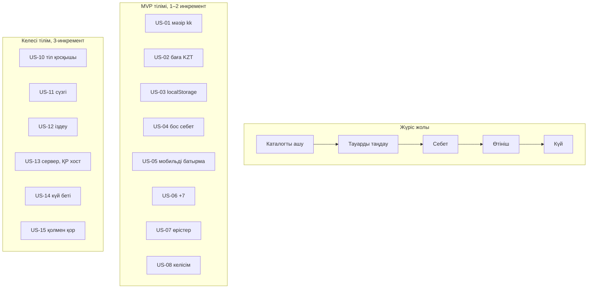

# ЗС 4. Мүдделі тараптар, story map, тарихшалар және NFR

**Жоба:** DressCo  
**Күні:** 2026-11-13  
**Трекердегі тізім:** `scripts/data/stories.csv` (US-01…US-18). Осы құжаттың қабылдау өлшемі US-01…US-15. US-16…US-18 сенімділік тілімі, 3-инкремент.

## 1. Мүдделі тараптар

Ықпал және мүдде 1–5. Топ: жақын ұстау (ықпал ≥ 4 және мүдде ≥ 4), қанағаттандыру (ықпал ≥ 4, мүдде ≤ 3), хабардар ету (ықпал ≤ 3, мүдде ≥ 4), бақылау (қалғаны).

| Тарап | Ықпал | Мүдде | Топ | Не күтеді |
| --- | --- | --- | --- | --- |
| Дүкен иесі, демеуші | 5 | 5 | Жақын ұстау | Комиссия азайсын, аптасына бір бет статус |
| Сатып алушы | 2 | 5 | Хабардар ету | Қазақша баға, телефонмен тапсырыс |
| Кассир / менеджер | 3 | 4 | Хабардар ету | Тапсырыс қағаз чатқа түспесін |
| Бухгалтер | 4 | 2 | Қанағаттандыру | Карта деректері өз базада болмасын |
| Заңгер (сыртқы, шақырылған) | 4 | 2 | Қанағаттандыру | Келісім мәтіні және сақтау мерзімі |
| Хостинг провайдері | 3 | 1 | Бақылау | Төлем мен SLA, апталық емес |
| Kaspi Магазин | 4 | 1 | Қанағаттандыру | Біз оның шартын бұзатын интеграция жазбаймыз |
| Оқытушы | 5 | 3 | Қанағаттандыру | Артефакт пакеті, қорғау 5 минут |

### Коммуникация жоспары

| Кім | Не | Жиілік | Арна | Иесі |
| --- | --- | --- | --- | --- |
| Демеуші | Бір бет: мерзім P85, топ-тәуекел, шешім сұранысы | Аптасына 1, жұма | Markdown + 15 мин кездесу | PM |
| Сатып алушы өкілі | Сұхбат қорытындысы, прототип | 4-апта және әр инкремент алдында | Бетпе-бет, жазба `docs/` | BA |
| Кассир | Тапсырыс күйінің үлгісі | 2-инкремент шолуы | Дүкенде 20 мин | BA |
| Бухгалтер және заңгер | Дерек өрістері мен мерзімі | Бір рет, 7-апта, содан өзгеріс болса | Құжат, чат емес | PM |
| Оқытушы | Зертхана пакеті | Әр апта | Репозиторий | PM |
| Хостинг | Инцидент, төлем | Оқиға бойынша | Пошта | Frontend |

Жасырын тарап: бухгалтер. Ол демоға келмейді, бірақ карта нөмірін сақтау шешімін бұғаттай алады. Сондықтан `ADR-0004` оған шолуға жіберіледі.

## 2. Екі сұхбат

Сұхбат оқу кейсінде жүргізілді: сатып алушы рөліндегі сыртқы адам және дүкен менеджері рөліндегі екінші адам. Жетелейтін сұрақ қойылмады («себет керек пе» деп басталмады). Сұрақ: соңғы рет киімді онлайн алғандағы қадамдар.

**Сұхбат A, 2026-11-06, 25 минут, сатып алушы.** Соңғы тапсырысын Kaspi-ден берген. Өз сайтқа кіргенде доллар бағасын «шетелдік дүкен» деп оқыған және жапқан. Телефонды +7 форматында жазуды күтеді. Келісім құсбелгісін көрмесе, мекенжайын қалдырмайды.

**Сұхбат B, 2026-11-07, 30 минут, менеджер.** Тапсырыс қазір жеке чатқа түседі, ауысым ауысқанда жоғалады. Оған алдымен тапсырыс тізімі керек, бағдарламалық қойма емес. Қазақша мәзірді иесі сұраған, менеджердің өзі орысша да оқиды.

Тұжырым, бэклогқа әсер еткені:

1. Баға теңгемен болмаса, қалған функцияның конверсиясы өлшенбейді → US-02 бірінші тілімде.
2. Телефон пішімі нақты → US-06.
3. Келісімсіз мекенжай жоқ → US-08.
4. Менеджерге алдымен тапсырыс күйі керек, қойма автоматтандыруы емес → US-14 MVP-ге, US-15 кейін.

## 3. User story map

Жүріс жолы: каталог → таңдау → себет → өтініш → күй. MVP тігінен кесілген: қазақша баға, себет, телефон, келісім. Іздеу, сервер, сақтық көшірме келесі тілімде.

## 4. Он бес user story

Қабылдау өлшемі Given–When–Then. Ұпай `stories.csv` ішіндегі келісілген мән. US-01…US-10 үшін покер дауысы сол файлда.

| ID | Эпик | Ұпай | Тарихша | Қабылдау |
| --- | --- | --- | --- | --- |
| US-01 | Локализация | 3 | Мәзір мен санат атауын қазақша көремін | Given ағылшынша үлгі. When бет ашылады. Then навигацияда «Жаңалық», «Киім», «Себет» тұрады, ағылшынша пункт қалмайды |
| US-02 | Каталог | 2 | Бағаны теңгемен көремін | Given демо-баға доллар. When витрина шығады. Then әр `price` теңге және ₸ белгісімен, доллар белгісі жоқ |
| US-03 | Себет | 5 | Себет бет жаңарғанда жоғалмасын | Given тауар қосылған. When бет қайта жүктеледі. Then сол тауар `localStorage` ішінде тұр. CI ережесі осы PR-мен жаңартылады |
| US-04 | Себет | 2 | Бос себетті түсінемін | Given себет бос. When себет ашылады. Then «Себет бос» мәтіні және каталогқа сілтеме бар |
| US-05 | Себет | 3 | Телефонда себет батырмасы басылады | Given ені 390 px. When батырма басылады. Then себет ашылады, элемент батырманың астында қалып қоймайды |
| US-06 | Тапсырыс | 2 | Телефонымды +7 деп тексеру | Given өріс. When 10 цифрдан өзге мән жіберіледі. Then жіберу тоқтап, қате мәтіні шығады |
| US-07 | Тапсырыс | 5 | Аты, телефон, мекенжай, түсініктеме өрісін толтырамын | Given себетте кемінде 1 тауар. When форма ашылады. Then төрт өріс пен жіберу батырмасы бар, бос атпен жіберілмейді |
| US-08 | Сәйкестік | 3 | Деректерді өңдеуге келісім беремін | Given форма. When құсбелгі бос. Then мекенжай сақталмайды. When белгі қойылды. Then келісім күні `localStorage` немесе сервер жазбасында қалады |
| US-09 | Сапа | 2 | Қатені бір секундта көремін | Given қате толтыру. When фокус өрістен шығады. Then мәтін 1 секундтың ішінде пайда болады |
| US-10 | Локализация | 5 | Қазақ және орыс тілін ауыстырамын | Given екі сөздік. When қосқыш басылады. Then мәзір, қате және батырма таңдалған тілде, баға валютасы өзгермейді |
| US-11 | Каталог | 5 | Санат бойынша сүзгілеймін | Given кемінде 2 санат. When санат таңдалады. Then басқа санаттың карточкасы көрінбейді |
| US-12 | Каталог | 5 | Атауы бойынша іздеймін | Given «көйлек» сұранысы. When 2 таңбадан көп енгізіледі. Then атауында сол қатар бар тауар ғана қалады |
| US-13 | Тапсырыс | 8 | Өтініш ҚР ішіндегі хостқа кетеді | Given келісім бар. When жіберу басылады. Then жауап коды 201, жазба ҚР хостында, карта өрісі жоқ |
| US-14 | Тапсырыс | 5 | Тапсырыс күйін қараймын | Given нөмір берілген. When бет ашылады. Then күй «қабылданды / жиналуда / берілді» біреуі және сол нөмірге тиесілі |
| US-15 | Каталог | 5 | Қорды қолмен жаңартамын | Given менеджер кірген. When қалдық өзгертіледі. Then витрина 1 минуттың ішінде сол қалдықты көрсетеді |

INVEST тексеруі: US-13 ең үлкені (8 ұпай). Ол 3-инкрементке қалдырылды, MVP-ге зорлап салынбайды. US-03 пен CI ережесі бір өзгерісте келеді, бөлек «техқарыз» тапсырмасына жыртылмайды.

## 5. Он екі функционалдық емес талап

Әр талап өлшенеді. «Жүйе жылдам» деген тұжырым жоқ.

| ID | Санат | Талап | Қалай тексеріледі |
| --- | --- | --- | --- |
| NFR-01 | Өнімділік | Каталогтың алғашқы мазмұны p95 **< 800 мс**, 50 бір мезгілдегі пайдаланушы, статика | k6 немесе браузердің 20 жүктемесі, p95 есебі |
| NFR-02 | Өнімділік | Қате мәтіні фокус шыққаннан кейін **≤ 1 с** | US-09, секундомер 10 қайталау |
| NFR-03 | Қолжетімділік | Айлық қолжетімділік витринада **≥ 99,5%**. Айлық қате бюджеті 30 × 24 × 0,005 = **3,6 сағат** | Uptime тексеруі, айлық есеп |
| NFR-04 | Масштаб | 42 карточкадан 200 карточкаға өскенде NFR-01 бұзылмауы үшін бет бір HTML жауабынан аспайды, сурет lazy | 200 карточкалық көшірмеде NFR-01 қайта өлшенеді |
| NFR-05 | Қауіпсіздік | PAN, CVV, толық карта нөмірі сақталмайды және журналға түспейді | Форма өрістерін шолу, gitleaks үлгісі CI-да |
| NFR-06 | Құқық | Менеджер қалдығын өзгертеді, сатып алушы өзгертпейді | US-15 рөлі жоқ сессияда 403 |
| NFR-07 | Аудит | Келісім жазбасында уақыт, нұсқа мәтіні, телефондың соңғы 4 цифры ғана | US-08 жазбасының өріс тізімі |
| NFR-08 | Журнал | Сервер қатесі сұраныс идентификаторымен жазылады, денесінде мекенжай жоқ | Сынақ тапсырысы, логты оқу |
| NFR-09 | Сақтық көшірме | Тапсырыс жазбасының RPO **≤ 24 сағат**, RTO **≤ 8 сағат** | Апталық қалпына келтіру жаттығуы, уақыт хаттамасы |
| NFR-10 | Интеграция | Тапсырыс JSON, UTF-8, хост Қазақстанда. Сыртқы төлем болса, тек redirect | US-13 жауабы және DNS |
| NFR-11 | Тіл | kk және ru толық. Ағылшынша жол пайдаланушыға шықпайды. Баға валютасы тілмен ауыспайды | US-01, US-10 |
| NFR-12 | Қолжетімділік (a11y) | Пернетақтамен себетке жетуге болады, мәтін контрасты WCAG 2.2 AA деңгейінде **≥ 4,5:1** | Tab реті, контраст өлшегіш |

Өзгеріс тәртібі: NFR сандық мәні өзгерсе, бұл baseline. Өзгеріс демеушіге мерзім немесе бюджет әсерімен бірге барады. Мысал: p95 шегін 800 мс-тен 200 мс-ке түсіру US-13-тің алдына CDN жұмысын қояды және 8 ұпайдан асады.
