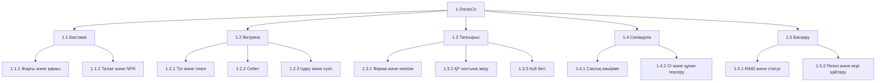
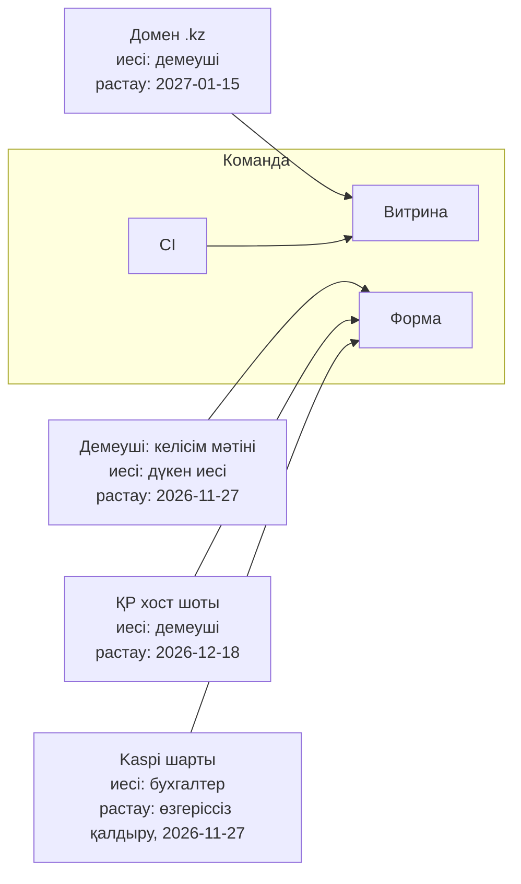

# ЗС 5. WBS, релиздер, тәуелділіктер, RACI және қуат

**Жоба:** DressCo  
**Күні:** 2026-11-13  
**Жеткізу:** гибрид (`ADR-0001`). WBS предиктивті пакетті, спринт икемді пакетті көрсетеді.

## 1. WBS, үш деңгей

### WBS сөздігі, 5 жұмыс пакеті

| Пакет | Ішінде | Сыртында | Дайындық өлшемі | Иесі |
| --- | --- | --- | --- | --- |
| 1.1.1 Жарғы және қаржы | Бизнес-кейс, жарғы, `financial_model.py` | Салықтық тіркеу | Скрипт шығысы жарғыдағы санмен бірдей | PM |
| 1.2.1 Тіл және теңге | US-01, US-02 | Орысша қосқыш | Доллар белгісі мен ағылшынша мәзір жоқ | Frontend |
| 1.2.2 Себет | US-03, US-04, US-05 | Серверлік себет | Жаңартқанда себет қалады, бос күй бар, ені 390 px | Frontend |
| 1.3.1 Форма | US-06, US-07, US-08, US-09 | Онлайн эквайринг | Келісімсіз жіберілмейді, қате ≤ 1 с | BA |
| 1.4.2 CI | `ci.yml`, құпия үлгісі, DORA скрипті | Ақылы сканер | `ubuntu-latest` жолында төрт қадам жасыл | QA |

## 2. Үш инкремент

| Инкремент | Күн | Мақсат | Құрамы | Белес дайындығы |
| --- | --- | --- | --- | --- |
| R1. Оқылатын витрина | 2026-11-20 | Сатып алушы бағаны түсінеді | US-01, US-02, NFR-11 қазақша бөлігі | Доллар және ағылшынша мәзір жоқ, демеуші бетті өзі ашқан |
| R2. Себет және өтініш | 2026-12-11 | Тапсырысты чатсыз қалдыруға болады | US-03…US-09, NFR-02, NFR-05, NFR-12 | 5 UAT сценарийі өтеді, PAN өрісі жоқ |
| R3. ҚР контуры | 2027-01-29 | Өтініш ел ішінде сақталады | US-10…US-15, US-16…US-18, NFR-03, NFR-09, NFR-10 | 201 жауап, RPO жаттығуы ≤ 24 сағ, CI жасыл |

Семестр қорғауы 2027-02-13. R3 пен қорғау арасында 2 апта буфер. Буфер әр тапсырмаға жайылатылмаған: ол жоспардың соңында тұр (Паркинсон заңы бойынша әр тапсырмаға қосылған резерв жұмсалып кетеді).

## 3. Сыртқы тәуелділіктер

Кемінде үш сыртқы тәуелділіктің иесі мен растау күні бар.

| ID | Тәуелділік | Иесі | Растау күні | Кешіксе не болады |
| --- | --- | --- | --- | --- |
| X1 | Келісім мәтінінің заңгерлік нұсқасы | Дүкен иесі | 2026-11-27 | US-08 мәтін орнына «нұсқа күтілуде» деп шығады, R2 қабылданбайды |
| X2 | ҚР ішіндегі хост шоты, карта байламайтын тариф | Демеуші | 2026-12-18 | US-13 R3-тен түсіп қалады, өтініш уақытша файлда қалады |
| X3 | `.kz` домен және HTTPS | Демеуші | 2027-01-15 | Витрина IP-мен ашылады, NFR-03 өлшенбейді |
| X4 | Kaspi Магазин шартын бұзбайтынын бухгалтер растайды | Бухгалтер | 2026-11-27 | Өз сайтты жарнамалау тоқтайды |

## 4. Топология және RACI

Team Topologies: бір stream-aligned команда. Жеке platform командасы жоқ, 4 адамға оны бөлу когнитивтік жүктемені екі еселейді. CI мен хостинг құжаты enabling практика ретінде QA-да, бөлек топ емес.

RACI: R — орындайды, A — жауап береді (біреу ғана), C — кеңеседі, I — хабардар.

| Артефакт | Демеуші | PM | BA | Frontend | QA |
| --- | --- | --- | --- | --- | --- |
| Жарғы, скоуп | A | R | C | I | I |
| Қаржы моделі | C | A | I | I | R |
| User story | I | C | A/R | C | C |
| NFR | I | A | C | C | R |
| Витрина коды | I | I | C | A/R | C |
| RAID | I | A/R | C | C | C |
| CI | I | I | I | C | A/R |
| Релиз шешімі | A | R | C | C | C |
| UAT хаттамасы | C | I | C | I | A/R |

## 5. Қуат, сағат

| Көрсеткіш | Есеп | Сағат |
| --- | --- | --- |
| Номинал | 4 × 6 × 15 | 360 |
| Фокус 0,8 | жиналыс, үй тапсырмасы, контекст ауысуы | 288 |
| Аптасына пайдалы | 288 / 15 | 19,2 |
| R1 үлесі, 2 апта | 19,2 × 2 | 38,4 |
| R2 үлесі, 3 апта | 19,2 × 3 | 57,6 |
| R3 үлесі, 6 апта | 19,2 × 6 | 115,2 |
| Буфер және басқару, қалған 4 апта | 19,2 × 4 | 76,8 |

288 сағаттың қосындысы: 38,4 + 57,6 + 115,2 + 76,8 = **288**. «100% жүктеу» жоспарланбайды: 0,8 коэффициенті онбординг пен басқа пәндер үшін қалдырылған. Мереке аптасы R3 буферінен жұмсалады, R1 күні жылжымайды.
